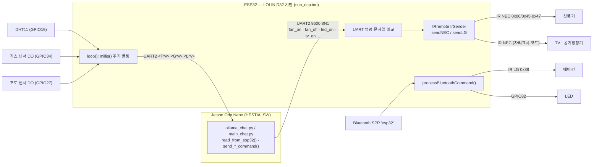

# HESTIA_FW — ESP32 센서 허브 · IR 가전 제어 · 얼굴 추적 서보 펌웨어

HESTIA(독거노인 대화형 홈 어시스턴트)의 **MCU 측 펌웨어**입니다.
Jetson Orin Nano와 UART로 연결되어 ① 실내 센서 값을 주기적으로 올려 보내고 ② Jetson이 보낸 문자열 명령을 IR 리모컨 신호로 바꿔 가전을 제어합니다.

> **English summary** — Firmware for an ESP32 (LOLIN D32-based carrier board). `sub_esp.ino` (Arduino-ESP32) periodically sends DHT11 temperature and digital gas / light readings to the Jetson over UART2 (9600 8N1, `<T^v>/<G^v>/<L^v>`), and turns text commands from the Jetson into IR NEC codes (fan uses real codes 0x45/0x47; TV / air purifier / LED are placeholders). A separate Bluetooth SPP path controls the air conditioner via IR (LG protocol) and an LED on GPIO32. `face_tracking_with_servo.c` is an ESP-WHO based 2-axis servo face-tracking experiment.

<!-- 데모 영상 링크: 확인 후 주석 해제 — https://www.youtube.com/watch?v=fuKamIi-SM0 -->

## 1. 시스템 구성

| 파일 | 대상 | 프레임워크 | 역할 |
|---|---|---|---|
| `sub_esp.ino` | ESP32 (LOLIN D32 기반, HESTIA_PCB 회로도 기준) | Arduino-ESP32 | 센서 주기 송신, UART/Bluetooth 명령 → IR·GPIO 제어 |
| `face_tracking_with_servo.c` | ESP-WHO 카메라 보드 (모델 확인 필요) | ESP-IDF + ESP-WHO | 얼굴 검출 bbox로 2축 SG90 서보(MCPWM 50 Hz) 추적 — 실험 코드 |

> MCU 표기: 회로도(HESTIA_PCB)는 **LOLIN D32(ESP32-WROOM-32)**, `sub_esp.ino`는 Classic Bluetooth(`BluetoothSerial`)를 사용하므로 **ESP32-S3가 아닌 ESP32**에서 빌드되는 코드입니다. 조직 프로필 README의 하드웨어 목록에는 "ESP32-S3 DEV Module"이 적혀 있으나, 이를 필요로 하는 코드는 없습니다. ESP32-S3가 얼굴 추적(ESP-WHO)용 별도 보드였는지는 확인이 필요합니다.

## 2. 핀맵 (`sub_esp.ino`)

| 기능 | 핀 | 비고 |
|---|---|---|
| UART2 ↔ Jetson | RX = GPIO16, TX = GPIO17 | `Serial2.begin(9600, SERIAL_8N1, 16, 17)` |
| 디버그 콘솔 | USB `Serial` 115200 | |
| DHT11 | GPIO19 | 온도만 송신 |
| 가스 센서 (디지털) | GPIO34 | active-low → `!digitalRead(34)` |
| 조도 센서 (디지털) | GPIO27 | active-low → `!digitalRead(27)` |
| IR 송신 | `PinDefinitionsAndMore.h`의 `IR_SEND_PIN` | IRremote 예제 헤더 (저장소에 미포함) |
| LED | GPIO32 | Bluetooth 명령 경로 |
| 서보 X / Y (`face_tracking_with_servo.c`) | GPIO12 / GPIO13 | MCPWM0A / MCPWM0B, 600–2400 µs |

## 3. 통신 프로토콜 (ASCII, 줄 단위 `\n`)

**ESP32 → Jetson** — `<타입^값>`

| 패킷 | 의미 | 주기 |
|---|---|---|
| `<T^25>` | DHT11 온도 (정수 °C) | 12 s |
| `<G^1>` | 가스 감지 1/0 | 13 s |
| `<L^0>` | 빛 감지 1/0 | 11 s |

**Jetson → ESP32 (UART)**

| 명령 | 동작 |
|---|---|
| `fan_on` / `fan_off` | IR NEC addr 0x00, cmd 0x45 / 0x47 |
| `tv_on/off`, `airpurifier_on/off`, `led_on/off` | IR NEC addr 0x04, cmd 0x08 (공통 자리표시 코드) |

**Bluetooth SPP (장치명 `esp32`)**: `airconditioneron/off` → IR **LG** (0x88, 0x40B0 / 0xC005), `ledon/ledoff` → GPIO32, `tvon/tvoff`, `airpurifieron/off` → IR NEC 자리표시 코드.

## 4. 빌드 & 플래시

**sub_esp.ino (Arduino)**
1. Arduino IDE 2.x + `esp32 by Espressif` 보드 패키지, 보드: LOLIN D32 계열
2. 라이브러리: Arduino-IRremote, DHT sensor library(Adafruit) + Adafruit Unified Sensor
3. IRremote 예제의 `PinDefinitionsAndMore.h`를 스케치 폴더에 복사
4. 업로드 후 시리얼 모니터(115200)에서 `Sent to Pi: <T^..>` 로그 확인

**face_tracking_with_servo.c (ESP-IDF, 실험)**
- ESP-WHO 예제 프로젝트에 소스를 넣어 빌드 (`extern "C" app_main` 사용 → C++로 빌드 필요). 레거시 MCPWM API(`driver/mcpwm.h`) 사용. 실제 빌드·동작 여부는 확인 필요.

## 5. 테스트 방법

- 자동화 테스트 코드는 없습니다.
- USB 시리얼 모니터에 입력한 문자열은 `Serial2`(Jetson 방향)로 중계되고, Jetson에서 받은 명령은 `Received from Pi: ...`로 출력됩니다.
- HESTIA_SW의 `ollama_chat.py`는 키보드 입력으로 같은 UART 명령을 보내므로 마이크 없이 펌웨어를 점검할 수 있습니다.

## 6. 한계 및 개선 계획

- 줄 단위 문자열 프로토콜 → 프레이밍·오류 검출 보강
- TV/공기청정기/LED UART 명령이 같은 자리표시 IR 코드 → 실제 리모컨 코드 등록, LED는 GPIO 경로로 통일
- 에어컨 제어가 Bluetooth 경로에만 있음 → UART 명령 추가
- `String` 동적 할당 반복 → 고정 버퍼 파서
- 주석의 송신 주기(2 s/3 s/2.5 s)와 실제 상수(12/13/11 s) 불일치, 주석의 "라즈베리파이"는 실제로 Jetson

## 7. My role

**이승석** — 전체 시스템 통합, Jetson 소프트웨어, 이 펌웨어, IR 가전 제어.

- `sub_esp.ino`: 센서 주기 송신, UART2 명령 파서, IR(NEC/LG) 가전 제어, Bluetooth 명령 경로
- Jetson(HESTIA_SW)과의 UART 프로토콜(`<T^v>/<G^v>/<L^v>`, `fan_on` 등) 정의·연동
- `face_tracking_with_servo.c`: ESP-WHO 기반 2축 서보 얼굴 추적 실험
